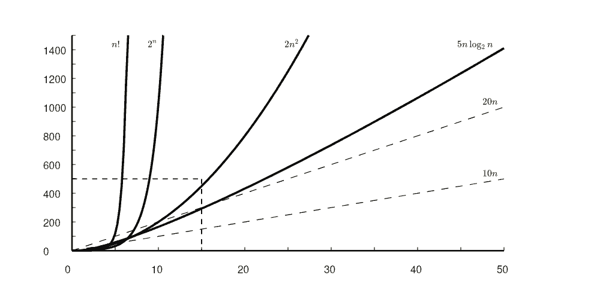
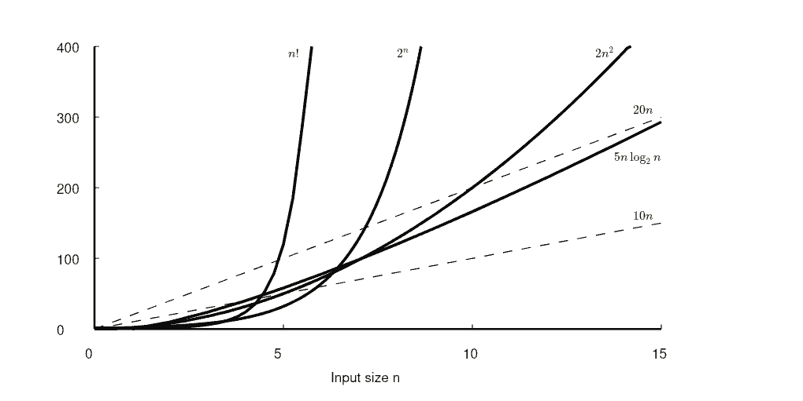

# Comparing Algorithms

## Problem

A task to be performed (input to output)

## Algorithm

A method or process to solve a problem

## Program

A concrete implementation of an algorithm in a language

## Algorithm Requirements

- Must be correct
- Must be composed of concrete steps
- Must be finite
- Must terminate

## Why Compare?

- Different algorithms solve the same problem
- Efficiency varies by input size or type
- Some are better for small data
- Some are better for large data

## Empirical vs Asymptotic

- Empirical: Run code and measure time
- Problems with empirical:
  - Programming effort
  - Implementation quality
  - Test case bias
  - Resource limits

## Asymptotic Analysis

- Measures efficiency as input size grows
- Focuses on growth rates
- Ignores constant factors and hardware specifics

## Basic Operations

- Operation with constant time
- Time does not depend on input values
- Examples: 
  - Adding two integers
  - Comparing two integers

## Input Size

- Usually the number of inputs processed
- Cold be the size of an input list or records in a data file

## Running Time Function

- $T(n)$ represents time as a function of size $n$
- $c$ is the cost of a basic operation
- $T(n) = cn$ for linear growth

## Example: Sequential Search

- Find largest value in array of size $n$
- Basic operation: Comparison
- Total comparisons: $n$
- Running time: $T(n) = cn$

## Example: Constant Time

- Copying first element of array
- Time is independent of $n$
- Running time: $T(n) = c_1$

## Example: Nested Loops

- Nested loops both running to $n$
- Basic operation: Increment
- Total operations: $n^2$
- Running time: $T(n) = c_2 n^2$

## Growth Rates

- Linear: $cn$
- Quadratic: $cn^2$
- Cubic: $cn^3$
- Logarithmic: $c \log n$
- Exponential: $c^n$
- Factorial: $n!$

## Growth Rate Comparison

- $n^2$ grows much faster than $n$
- $2^n$ grows much faster than $n^2$
- Constant factors only shift the curves
- Growth rate determines long-term behavior

## Growth Rate Table

| $n$ | $\log n$ | $n$ | $n \log n$ | $n^2$ | $n^3$ | $2^n$ |
|---|---|---|---|---|---|---|
| 16 | 4 | 16 | 64 | 256 | 4096 | 65536 |
| 256 | 8 | 256 | 2048 | 65536 | 16.7M | $2^{256}$ |
| 1024 | 10 | 1024 | 10240 | 1.04M | 1.07B | $2^{1024}$ |

---

---

## Exercise

Identify the growth rate for an algorithm that checks every pair of elements in a list of size $n$ to see if they are identical.

## Exercise

Compare $T(n) = 100n$ and $T(n) = n^2$. At what value of $n$ does the quadratic algorithm become slower?
